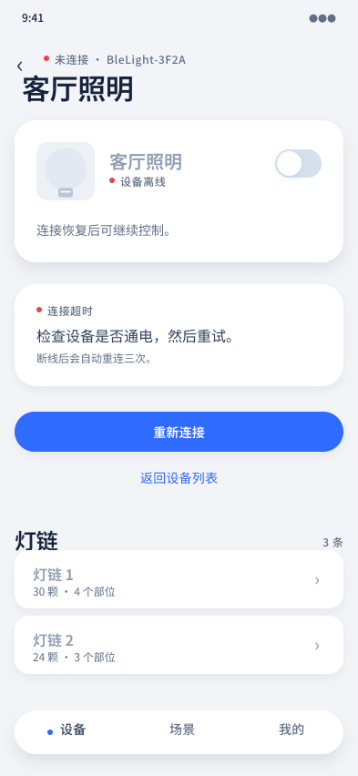

# 设备详情 · 错误（未连接）

## 覆盖的态

- 错误态：设备离线、连接超时

## 与规范的偏离

无。

## 结构

- 眉标改「未连接 · BleLight-3F2A」（红点）
- 顶部设备卡：设备名雾色、状态微标签「设备离线」（红点）、开关禁用、说明「连接恢复后可继续控制。」
- 错误白卡：红点 + 「连接超时」+ 「检查设备是否通电，然后重试。」+ 「断线后会自动重连三次。」
- 主按钮「重新连接」+ 文字动作「返回设备列表」
- 灯链列表保留但整体禁用（雾色名 + 不可点）
