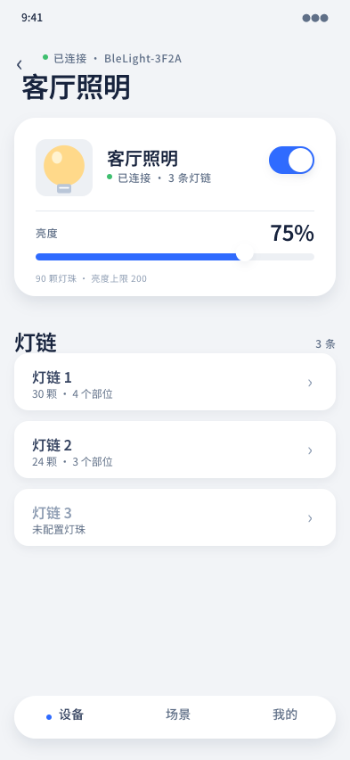

# 设备详情 · 常态

## 覆盖的态

- 常态：已连接、开灯、亮度 75%

## 与规范的偏离

无。

## 结构

- 返回 + 眉标「已连接 · BleLight-3F2A」+ 标题「客厅照明」
- 顶部设备卡：图标砖 + 设备名 + 状态微标签 + 总闸开关；分隔线下方亮度标签 + 75% + 滑块 + 上限说明
- 灯链区块：标题「灯链」+ 计数「3 条」
- 三条下钻行：灯链名 + 灯珠数/部位数 + `›`；未配置的链用雾色
