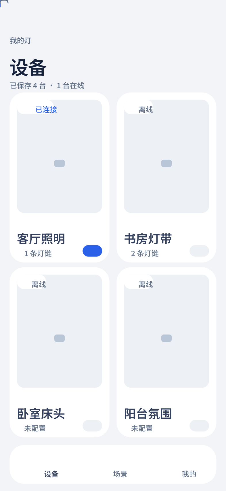

# 设备列表 · 双列卡片（v2）

## 覆盖的态

- 常态：4 台设备，两列网格；一台已连接（绿点 + 开关开 + 封面左上「已连接」标），两台未连接（红点），一台未配置（灰点）

## 与规范的偏离

无。字号按 `docs/design.md` §3 字号表重算（32.49/41.92/25.15/20.96/16.77/14.67/12.58/10.48pt），
颜色全部取自 §4 变量。

## 结构

- 页面眉标「我的灯」+ 标题「设备」+ 右上「+」圆钮
- 摘要行「已保存 4 台 · 1 台已连接」
- 双列设备卡：通栏封面图区（浅灰底 + 暖黄灯泡插画）→ 设备名 → 状态点 + 元信息 + 右下开关
- 底部三项胶囊导航（128rpx 高），当前项「设备」，三个图标为矢量描边
