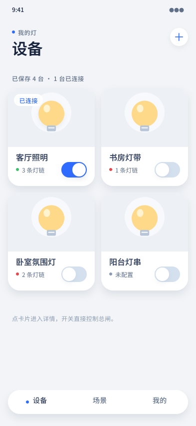

# 设备列表 · 双列卡片

## 覆盖的态

- 常态：4 台设备，两列网格；一台已连接（绿点 + 开关开 + 封面左上「已连接」标），两台未连接（红点），一台未配置（灰点）

## 与规范的偏离

无。

## 结构

- 页面眉标「我的灯」+ 标题「设备」+ 右上「+」圆钮
- 摘要行「已保存 4 台 · 1 台已连接」
- 双列设备卡：通栏封面图区（浅灰底 + 暖黄灯泡插画）→ 设备名 → 状态点 + 元信息 + 右下开关
- 底部三项胶囊导航，当前项「设备」
