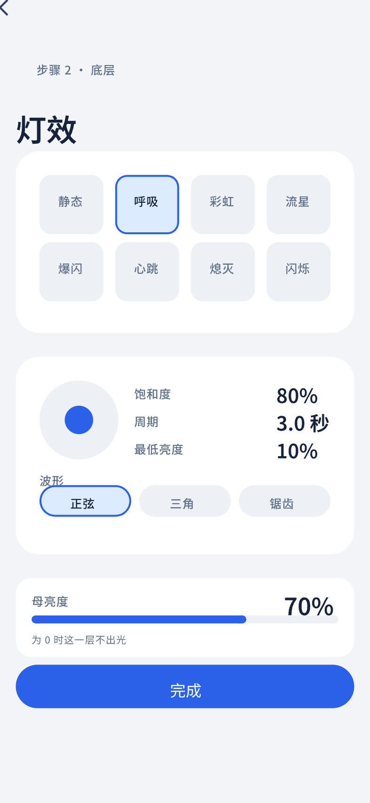

# 灯效参数面板 · 呼吸

## 覆盖的态

- 常态：选中「呼吸」，显示色相环、饱和度、周期、波形、最低亮度、母亮度

## 与规范的偏离

无。

## 结构

- 返回 + 眉标「步骤 2 · 底层」+ 标题「灯效」
- 灯效选择器：4 列 × 2 行共 8 个图标砖，选中项 `--accent-wash` 底 + `--accent` 描边
- 参数区：色相环 + 右侧三行「标签左 · 数值右」（饱和度 / 周期 / 最低亮度）+ 下方波形三选一
- 母亮度卡：「母亮度 70%」+ 滑块 + 脚注「为 0 时这一层不出光」
- 底部主按钮「完成」

## 待补的态

本稿只画「呼吸」被选中。以下需要出稿：

- 其余七种灯效的参数面板（按类型整体替换）
- 空层（叠加层未启用）
- 越界输入（就地拦截，主按钮禁用）
- 熄灭选中（无参数）
