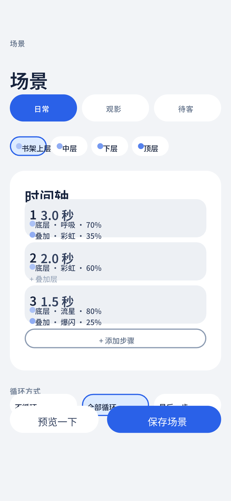

# 场景时间轴 · 日常

## 覆盖的态

- 常态：「日常」场景选中，书架上层部位有 3 个步骤

## 与规范的偏离

无。

## 结构

- 眉标「场景」+ 标题「场景」
- 场景切换条：三段等宽胶囊（日常 / 观影 / 待客），选中 `--accent` 填充白字
- 部位选择条：横向胶囊，选中 `--accent-wash` 底 + 色点 + 部位名
- 时间轴卡：步号 + 时长 + 底层灯效 chip + 叠加层 chip（空层显示「+ 叠加层」）+「+ 添加步骤」虚线行
- 底部悬浮操作条：次按钮「预览一下」+ 主按钮「保存场景」

## 待补的态

本稿只画常态。以下需要出稿：

- 空态（该部位无步骤）
- 8 步已满
- 时长越界（就地提示）
- 步骤拖动排序
- 编辑中提示条
- 部位关闭（降透明 + chip）
- 循环方式三分段控件（本稿放在按钮下方，被悬浮条遮挡，需下移或改为可见区域）
